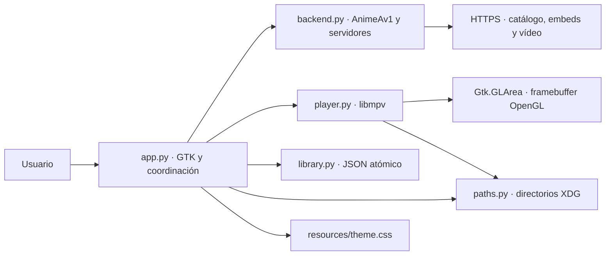
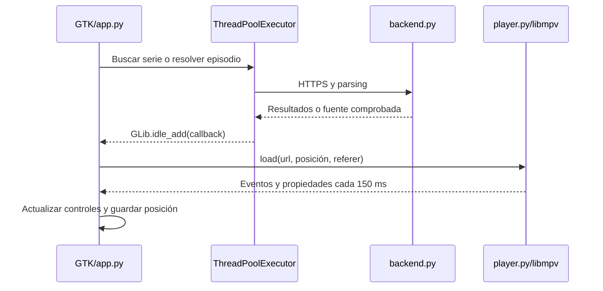

# Arquitectura

AniStream es una aplicación de escritorio de un único proceso. No tiene servidor HTTP, base de datos remota ni cuenta de usuario. El acceso a contenido externo se realiza por HTTPS; el vídeo se decodifica con la biblioteca nativa libmpv y se dibuja dentro de GTK.

## Componentes y dependencias



| Módulo | Responsabilidad | Límite |
| --- | --- | --- |
| `app.py` | Vistas, controles, favoritos y coordinación de tareas | Contiene actualmente el controlador y la interfaz en la misma clase; no es una arquitectura MVC estricta |
| `backend.py` | Descubrir series, episodios y fuentes; comprobar enlaces | No conoce GTK ni modifica la biblioteca |
| `player.py` | Ciclo de vida de libmpv, eventos, comandos y renderizado | No busca series ni escribe el historial |
| `library.py` | Leer, validar las secciones y guardar el estado | No contiene reglas de interfaz ni lógica de red |
| `paths.py` | Resolver ubicación de datos | No realiza instalación ni migraciones |
| Instalador | Copiar la aplicación y crear lanzadores | No copia la biblioteca del desarrollador ni descarga vídeos |

## Búsqueda y reproducción



1. El proveedor obtiene el catálogo y las portadas. La interfaz ejecuta las peticiones en un pool de seis trabajadores.
2. Al seleccionar una serie se leen los episodios del estado HTML serializado, con un respaldo basado en enlaces del documento.
3. Para reproducir se extraen únicamente los servidores del bloque `embeds`, no del bloque de descargas.
4. Se prueban MP4Upload y después Voe; cada uno puede intentarse dos veces. La resolución de Voe decodifica datos del reproductor, sin ejecutar scripts del sitio.
5. Antes de cargar, se consulta un rango de hasta 16 KiB. En HLS se recorren listas hasta comprobar un fragmento. Esto detecta algunos fallos tempranos; no garantiza que los fragmentos posteriores estén disponibles.
6. La URL temporal y su Referer se entregan a libmpv; no se guardan en la biblioteca.
7. Un error inicial o más de 22 segundos sin iniciar reproducción permite avanzar a la siguiente fuente. «Reintentar» vuelve a consultar los servidores.

`generation` evita aplicar búsquedas obsoletas. `play_request` y `attempt_id` descartan resultados de una reproducción o intento anterior. Las peticiones de red ya iniciadas no se cancelan; terminan según sus límites de tiempo. Los errores durante una reproducción ya iniciada pueden requerir pulsar Reintentar.

## Renderizado y concurrencia

- GTK y las mutaciones de widgets se ejecutan en el hilo principal.
- Los trabajadores de red devuelven sus resultados mediante `GLib.idle_add`.
- libmpv tiene hilos internos. Su callback de actualización agenda un redibujado, nunca modifica GTK directamente.
- `Gtk.GLArea` crea el contexto OpenGL. En `render`, libmpv recibe el framebuffer actual y las dimensiones físicas del área.
- Los comandos de reproducción son asíncronos. El sondeo de eventos no bloquea el hilo de renderizado.
- El contexto de renderizado se libera antes de destruir el núcleo de mpv.
- Antes de `mpv_create`, se fija **solo `LC_NUMERIC=C`**. GTK adopta el idioma del escritorio y libmpv rechaza locales numéricos como `es_MX.UTF-8`; no se cambia todo `LC_ALL`.
- La firma de `loadfile` se adapta según la versión de mpv, porque cambió a partir de 0.38.

## Controles superpuestos

`Gtk.Overlay` mantiene el vídeo como hijo principal. Dos `Gtk.Revealer` contienen el título y los controles; no reservan filas fuera del vídeo. Se usa una transición de opacidad y un temporizador de 2,5 segundos.

El movimiento real del puntero, las acciones y el teclado muestran los controles. El cambio de widget bajo un cursor inmóvil no reinicia el temporizador. No se ocultan durante un arrastre, cuando hay foco visible de teclado dentro de la barra o mientras se informa un error. Los botones conservan etiquetas accesibles y tooltips.

## Persistencia

La instalación utiliza dos ubicaciones separadas:

```text
~/.local/bin/anistream                         lanzador
~/.local/bin/anistream-uninstall               desinstalador
$XDG_DATA_HOME/anistream/application/           copia instalada de código y documentación
$XDG_DATA_HOME/anistream/library.json           datos personales
$XDG_DATA_HOME/anistream/*.img                  caché de portadas
$XDG_DATA_HOME/anistream/*.log                  diagnósticos
$XDG_DATA_HOME/applications/io.github.Zuaza796.AniStream.desktop
```

`XDG_DATA_HOME` tiene por defecto `~/.local/share`. `ANISTREAM_DATA_DIR` permite aislar los datos de una ejecución de prueba; no cambia la ubicación del instalador.

La biblioteca conserva cuatro mapas: `favorites`, `history`, `positions` y `durations`. Las claves de serie son rutas del proveedor; las posiciones están indexadas por número de episodio convertido a texto. Se mantienen las bibliotecas anteriores y se agregan las secciones ausentes. Un JSON inválido se aparta como `library.json.invalid`. El guardado escribe un temporal en el mismo directorio, sincroniza y reemplaza el archivo de forma atómica.

No hay bloqueo entre varios procesos que escriban sobre la misma biblioteca; las pruebas usan directorios independientes. Los logs de libmpv pueden contener enlaces temporales: deben revisarse antes de compartirlos.

## Decisiones y límites actuales

Se usa Python + GTK para aprovechar bibliotecas disponibles en Linux y libmpv para mantener reproducción integrada. Se elige JSON por el tamaño reducido del estado local. El instalador usa paquetes nativos para evitar compilar PyGObject con pip.

El proveedor depende de HTML y formatos de terceros que pueden cambiar. No hay soporte offline, descarga de capítulos, cuentas, sincronización ni selección explícita de idioma. La detección de distro cubre familias concretas, no todas las distribuciones Linux. Las pruebas automáticas sin red no sustituyen una prueba gráfica y de reproducción real.

## Picture-in-Picture

La vista del reproductor se mueve entre la ventana principal y una `Gtk.ApplicationWindow` secundaria. La barra compacta conserva pausa, silencio, progreso, tiempo y el botón de retorno. La ventana principal muestra un acceso para recuperar el vídeo o explorar el catálogo. Cerrar la ventana flotante restaura el reproductor; cerrar la principal termina ambos.

GTK recrea el contexto OpenGL al cambiar de ventana. Durante esa transferencia `player.py` mantiene vivo el mismo núcleo libmpv, libera solo el contexto de renderizado y conserva URL en memoria, posición, pausa, silencio y volumen. Al realizar el área en su nueva ventana crea otro contexto y recarga la fuente desde la posición guardada. Puede haber una breve recarga, especialmente en streaming; no se crea un segundo reproductor ni se duplica el audio.

`pip_window.py` configura únicamente la ventana del propio PID y título PiP. En Hyprland aplica flotación, tamaño 480×300, ubicación inferior derecha, fijación entre espacios y elevación; admite dispatchers clásicos y Lua. No modifica archivos de configuración ni reglas persistentes. Para otros gestores se utiliza la relación transitoria de GTK: mantenerse sobre aplicaciones ajenas depende del compositor.

## Biblioteca e inicio

`app.py` mantiene el objeto de persistencia como `library_store` y la navegación como `show_library`, evitando que un atributo oculte el método de interfaz. `generation` invalida tanto resultados como errores de búsquedas anteriores al cambiar de sección.

`library.py` deriva las tarjetas de continuación de `history`, `positions` y `durations`, sin crear otra biblioteca ni cambiar las claves de las instalaciones anteriores. `record_progress` añade el episodio al historial únicamente tras recibir una posición positiva de reproducción; no se registra un simple intento de resolver una fuente. El historial conserva un anime por ruta y el último episodio reproducido, con `watched_at` opcional. El orden de inserción mantiene la compatibilidad con registros antiguos sin fecha.

El inicio dibuja primero las tarjetas locales de «Continuar viendo» y después carga el catálogo. Solo aparecen episodios con posición positiva y, si se conoce su duración, con menos del 95 % visto y más de tres segundos restantes. Los terminados permanecen en Historial. No se buscan episodios anteriores de una serie cuyo último episodio ya terminó.

Las tarjetas de continuación muestran episodio, posición y progreso, y recuperan la lista de episodios antes de reproducir para que «Anterior» y «Siguiente» correspondan a esa serie. Los favoritos guardan solo metadatos de la serie; los campos transitorios de las tarjetas no se escriben allí. Volver al inicio o salir de reproducción actualiza la sección local.
